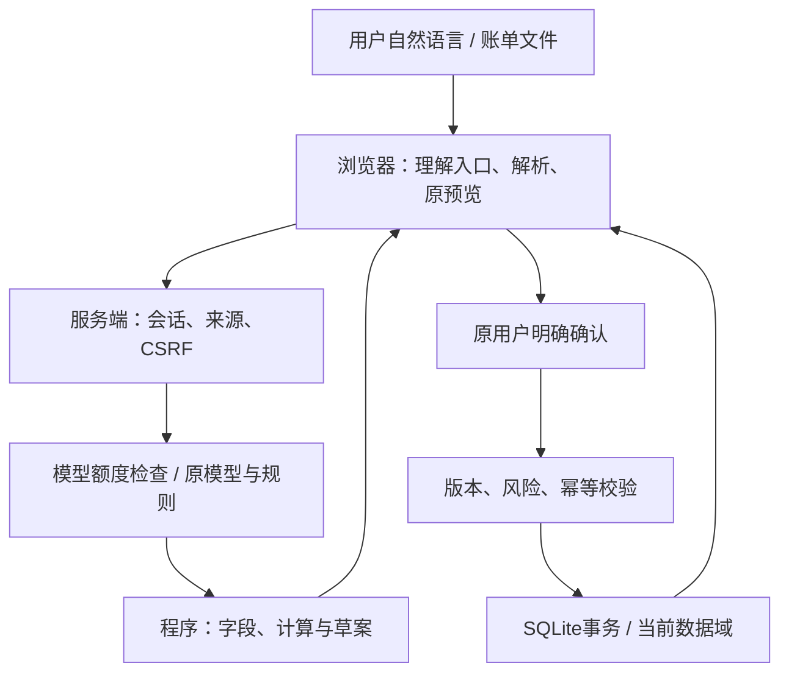

# 钱程 v59：修复交付与提交材料数据底稿

日期：2026-11-01，北京时间。以用户上传的 `Qiancheng-v58d-CloudBase.zip` 为唯一产品基线，原件保留，在新目录修改。此文件是材料制作与核验的底稿，不是最终01技术文档或04安全自评PDF。

## 1. 本版结果与身份

**已完成本轮五项中的实现修复与范围内验证。第4项游客高风险权限政策仍待确认，保留原验证；原有“加500元”敏感度口径问题按保留计算模型要求未改，不能声称全部质量检查通过。**

| 项目 | 实际结果 |
|---|---|
| 产品版本 | v59，package与运行接口统一为1.9.45 |
| CloudBase文件 | `Qiancheng-v59-CloudBase.zip`，830,871字节，70个文件 |
| SHA-256 | `ed31576c0c1641291031d37035efd931a360083570691a1800474a0238ec136d` |
| 原基线SHA-256 | `4b5390c8b692e9e5a78839db802046b521ea9a8d7347dbf24149d75202dc03a4` |
| npm test | **158/158通过**，含原138项和新增20项 |
| 前端控制器补充 | **4/4通过**；使用DOM适配器与真实本地HTTP，非真实浏览器 |
| 另行材料核验 | **40项中39通过、1项未通过**，未通过项A04见第5节 |
| 语法检查 | **60/60个MJS通过**，44个运行模块、14个测试文件及2个辅助模块 |
| 压缩包检查 | CRC完整、根目录Dockerfile、解压文件逐一相同、解压后启动与游客API通过 |
| 未验证 | Docker镜像实际构建、真实CloudBase、真实模型、真实桌面/手机浏览器 |

158项中有源码断言、计算/规则测试、模型模拟响应、前端控制器模拟和部分本地HTTP，不是158个真实浏览器端到端场景。各组测试不可重复相加成用户成功率。

## 2. 按本轮修改指令逐项说明

| 项目 | 结论 | 修改及边界 |
|---|---|---|
| 真实/模拟计算边界 | 新操作已修复 | 复用同账号的数据域隔离，在原确认成功后保存模拟现金结果；预览/取消不切换。原真实账单、聊天与业务结果可用原返回入口找回。纯模拟余额联动保留。 |
| 订阅实际结果与回执 | 已修复 | 成功回执统一为“已记录〔名称〕模拟取消。真实扣费仍需到原平台关闭，历史支出不变。”；原分析—追问—预览—确认—回主线不变。 |
| 聊天日额度 | 已修复 | 40/账户/日、500/全站/日只统计模型调用尝试；原规则服务不扣模型额度，额度耗尽时仍可接续。基础写请求限流保留。 |
| 游客红色操作 | **待权限政策确认** | 已复现随机密码导致无法绑定TOTP；未取消验证、未提高阈值、未强制注册、未增加流程，只如实说明本次未执行、草案保留。 |
| 重复分析资源 | 已修复 | 以同日、同商户、同额分组和一小时滑动窗口替代两两扫描，仍精确计数；最多保存200组线索，在原提示中说明截断。 |

原设计中转账和新生成的还款一直是明确的沙箱操作（程序写入 `simulated:true`，界面提示银行业务模拟）。因此没有过滤全部模拟流水或删除模拟体验。本版将它们在真实账单中的新现金效果放入同账号模拟数据域，账户ID不变、确认次数不变，未新建游客身份。

关联已有真实到账流水仍是原流水的性质核对，不额外增加现金，也不进入新模拟域。新增模拟副本后再导入同一真实账单，会复用原真实域的导入与去重结果，不把模拟结果拼入真实余额。

升级前已混合的历史数据无法仅凭当前ZIP可靠重建原真实余额，本版不会静默删除它们。原有大报告快照也不会被自动重写；用户可用原分析入口更新结果。

### 实际改动文件

| 文件 | 用途 |
|---|---|
| `lib/bill-workspaces.mjs`、`server.mjs` | 复用数据域隔离、确认绑定与返回、跨域风险计数、模型额度计数及游客状态提示 |
| `lib/agent.mjs`、`lib/subscription-agent.mjs` | 模型调用前扣额与规则降级、如实说明回执 |
| `lib/domain.mjs` | 仅更正订阅模拟取消的成功文案，未改账本算法 |
| `public/app.mjs` | 隔离后的原任务接续、原草稿保存和恢复、模拟取消回执 |
| `public/engines/bill-analysis.mjs`、`public/bill-ui.mjs` | 重复线索分组与限量保存、原提示内显示总数和截断 |
| `package.json`、`public/index.html` | 版本号与资源缓存版本 |
| `tests/v59.test.mjs` | 新增20项与本轮修复直接相关的检查 |
| `README.md`、`DEPLOYMENT.md` | 补充源码包运行、部署说明和已知边界 |

原首页背景、样式文件、目标计算引擎、目标页面和原主要入口保持不变。

### 风险验证没有因隔离而被绕过

跨数据域按同一账户的交易ID去重累计当日已模拟流出，避免返回真实域后重新开始计数。测试中，先模拟100元、返回原域再准备901元，仍判定红色。本版没有改变 `risk()`的1000元阈值或TOTP规则。

## 3. 修复前后资源实测

修复前：2000笔同日同商户同额记录，生成1,999,000组候选，报告JSON为**153,703,415字节**，本地一次运行约**4047.79ms**。

修复后，相同2000笔输入仍精确得到1,999,000组总数，只保存200组，报告JSON为**14,947字节**，一次本地运行约**4.31ms**。

10000笔最坏输入：总数**49,995,000组**、保存**200组**、报告JSON **14,952字节**，一次本地运行约**13.87ms**。另有150组随机小样本与原两两比较逐项对照，一小时边界、无效时间及已排除/已重复记录的规则均有检查。

这些数字是本地功能基准，不是线上SLA；JSON大小不是峰值内存。算法不再枚举全部匹配对象，新增结构约为分组/排序开销与最多200个候选，不把部分输出误说成全部候选均已保存。

## 4. 技术、Agent与权限的统一口径

- 前端：原生HTML/CSS/JavaScript模块，账单原文件先在浏览器解析，确认后标准化流水提交服务端保存。
- 后端：Node.js原生HTTP、SQLite、JSON业务状态；无第三方npm运行依赖。Docker基于Node24 Alpine，默认端口3000，非root用户运行。
- Agent：模型参与结构化意图、证据字段与订阅优先项理解；程序验证金额、对象、日期并调用已有功能。金额、账本、情景模拟和保存状态由程序确定。没有真实银行转账或平台退订接口。
- 确认：草案5分钟有效，检查账户归属、数据版本、来源、CSRF及幂等；红色操作另检查TOTP。普通“好”“继续”不代替关键确认。
- 权限分级：认证状态、账户归属和动作风险，不应写成管理员/运营/客服等完整RBAC。
- 数据保存：业务结果在SQLite；服务端会话保存最近最多8条消息及上下文。前端未发送草稿、页面值、业务结果的保存层次不同，不能承诺所有草稿跨刷新永久保留。
- 模型额度：实际模型调用尝试前原子检查40/账户/日和500/全站/日。耗尽时无上游请求，按规则继续；必须依赖模型而规则无法理解时，明确暂不可用并保留原上下文。每分钟120次写请求、入口限流等仍保留。

真实模型未在本次接通。测试中的 `mode: ai` 分支使用本地模拟接口或模拟响应验证，不是可宣传的真实识别准确率、响应速度或幻觉率。

## 5. 可复现的储蓄方案核心数据

固定种子20261017，每组2000条路径；零投资收益。三档使用约100%、80%、60%静态结余，并保留既有生活预算。比例是未校准假设下的情景频率，不能称个人未来真实成功率；“截止前曾达标”与“期末仍达标”应分别记录。

学生样本：武汉宿舍、生活费2000、存款2000、房租0、无兼职无实习、步行骑车、非必要消费400元。生活预算1530元、静态结余470元、自然储蓄尝试350元/月。G03专项核验把起点改为0，不是默认学生条件。

职场样本：深圳互联网新人、月收入8000、存款12000、房租1800、合租地铁、非必要消费800元。生活预算4360元、静态结余3640元、自然储蓄尝试3450元/月。

**此表是载入账单前的独立快照。金额单位元，“金额/比例”为月储蓄与截止前曾达标比例。**

| ID | 样本 | 目标 | 月数 | 起点 | 生活预算/月 | 自然储蓄比例 | 冲刺 金额/比例 | 均衡 金额/比例 | 宽松 金额/比例 |
|---|---|---|---|---|---|---|---|---|---|
| G01 | 学生 | 5,000 | 6 | 2,000 | 1,530 | 0% | 470 / 0% | 370 / 0% | 280 / 0% |
| G02 | 学生 | 6,000 | 12 | 2,000 | 1,530 | 31.65% | 470 / 98.05% | 370 / 66.6% | 280 / 0% |
| G03 | 学生 | 3,000 | 12 | 0 | 1,530 | 99.05% | 470 / 99.95% | 370 / 99.4% | 280 / 85.6% |
| G04 | 职场新人 | 40,000 | 12 | 12,000 | 4,360 | 89.6% | 3,640 / 90.4% | 2,910 / 83.25% | 2,180 / 0% |
| G05 | 学生 | 1,000 | 6 | 2,000 | 1,530 | 100% | 0 / 100% | 0 / 100% | 0 / 100% |
| G06 | 学生 | 12,000 | 24 | 2,000 | 1,530 | 0% | 470 / 4.95% | 370 / 0% | 280 / 0% |

重复同输入计算一致。G01应如实指出三档都吃力；G02可用于比较不同节奏；G05起点已覆盖，不能写成新增储蓄成果。本轮 `goal.mjs`、`coach-scenario.mjs` 与原包字节相同，未改这些数据。

### 唯一未通过的材料一致性核验：A04

“每月多存500元”卡片直接试算自然储蓄额+500，实际预览先受已有月结余上限约束，因此部分显示不一致：

| 条件 | 卡片显示提升 | 实际预览提升（整数） | 实际预览自然比例 |
|---|---|---|---|
| G01：5000元/6月 | 14个百分点 | 0个百分点 | 0% |
| G02：6000元/12月 | 68个百分点 | 66个百分点 | 98.05% |
| G06：12000元/24月 | 61个百分点 | 5个百分点 | 4.95% |

这是既有敏感度展示与实际预览口径问题，未扩展本轮五项修复去改计算模型。不能把14或61个百分点当作实际预览效果。G01使用原“多给6个月”的预览则一致：自然储蓄比例0%→99.05%，三档99.95%、99.4%、85.6%，目标与期限在确认前不保存。

## 6. 当前月 2026-11 的账单与往来数据

样本均为整月虚构流水，包含运行当日之后的日期，不是截至当天真实消费，也不代表平台真实价格。

| 样本 | 流水总笔数 | 已确认收入 | 消费 | 待核对转账 | 订阅 | 现金 |
|---|---|---|---|---|---|---|
| 学生 B01 | 27 | 2000 | 1488 | 100 | 58 | 2412 |
| 职场 B02 | 51 | 0 | 4155 | 600 | 54 | 7245 |

学生现金：2000期初+2000生活费−1488消费−100待核对转账=2412元。职场现金：12000期初−4155消费−600待核对转账=7245元；8000元工资只是预算输入，没有样本工资入账，不能再加入当前现金。

学生订阅为腾讯视频15、爱奇艺25、QQ音乐10、网易云8，共58元；职场订阅为爱奇艺25、腾讯视频15、QQ音乐6、网易云8，共54元。金额全部为虚构演示数据，不可宣传为真实平台价格。每项在样本中各1笔，同类功能不等于浪费或重复扣款，单笔会员也不证明仍在自动续费。

学生有一对40元桌游疑似重复，职场有一对68元。默认尚未标记排除，当前消费仍包含它们；不要写“已自动去重”或“已退款”。

学生预算线索：夜宵4笔115元，少两次试算57.50元；娱乐3笔130元，试算26元；饮品8杯40元，试算18.33元。职场夜宵8笔284元，试算71元；娱乐3笔220元，试算44元。它们是预览假设，不是已省下或增加现金。本次HTTP采纳检查用的是5元假设，确认后新增1条行动，现金与历史消费不变，不要把5元与上述默认建议混称为同一决策。

### 100元既有垫付的完整守恒路径 P01

| 步骤 | 现金 | 待收 | 历史消费 |
|---|---|---|---|
| 关联前 | 2412 | 0 | 1488 |
| 关联垫付后 | 2412 | 100 | 1488 |
| 模拟提醒后 | 2412 | 100 | 1488 |
| 确认归还40元 | 2452 | 60 | 1488 |
| 再确认归还60元 | 2512 | 0 | 1488 |

P01是纯演示样本，余额联动保留，没有过滤所有 `simulated`。提醒仅存入模拟信箱。另有独立100元AA检查：只扣100元现金，对方应还40元，本人60元作为不新增现金流的组成项。

真实账单隔离修复用例采用1000元已确认起点及10元合成真实格式支出：原真实域990元；确认100元模拟垫付后，模拟副本890元、待收100元；返回真实域仍为990元且原数据逐项相同。关联真实已导入还款不再增加现金，新生成模拟还款仅在模拟副本改变余额。

## 7. 已运行的安全与状态检查

| 检查 | 本次结果 |
|---|---|
| 未认证/缺CSRF/跨站来源 | 401/403按预期拒绝 |
| 普通“好”“继续” | 不自动保存或付款 |
| 重复commit | 只写入一次，另一次replayed |
| 过期、他人、旧版本/旧数据域草案 | 按预期拒绝 |
| TOTP | 注册账户密码复核绑定成功，红色动态码成功，同一步码重放被拒绝 |
| 真实/模拟隔离 | 同账户、原确认、原返回入口，业务与草稿可找回 |
| 真实流水还款关联 | 不重复增加现金 |
| 模型40/500日额耗尽 | 已有规则继续，未请求上游，草稿/上下文保留 |
| 基础请求限流 | 保留，120次写请求达到限制后仍429 |
| 本地审计链 | 重算一致，但无外部签名，不是绝对不可篡改 |
| 同一DATA_DIR重启 | 身份与隔离记录恢复；不外推为CloudBase持久化已验收 |

原有红色规则仍为当日已模拟流出加本次金额超过1000元，以及模拟申购等特定操作。未将其概括为成熟银行风控；已有真实入账关联是否应适用某些风险验证，仍属权限政策需审视的边界。

## 8. 待确认与未验证，材料必须保留

1. **游客高风险权限政策待确认。** 原安全门槛保留，普通100元流程可完成，不能说游客能完整体验所有红色操作。本次没有增加注册或另一条验证流程。
2. **A04敏感度口径已知问题。** 见第5节，尚未修复，不能写成所有数值一致性检查均通过。
3. 升级前已混合历史不自动修复，旧的大快照不自动改写；不能宣称所有历史真实余额均已无损恢复。
4. 未接真实模型、真实浏览器/手机、Docker构建或实际CloudBase生产环境。API对话效果测试含规则与模拟模型，不提供真实模型准确率、幻觉率或成本结论。
5. SQLite与TOTP/业务数据的本地保存、Secure Cookie配置、代理IP限流、实例数量与持久化仍需生产核验。审计链缺少外部锚定，没有完整后台多角色RBAC或全面自由输入脱敏。
6. 沿用原v58方案页面手选后预览的预设，未移植其他版本的自动推荐预览设计，材料不要夸大。

## 9. 各项材料如何取数

| 材料 | 可复用数据 | 边界 |
|---|---|---|
| 01技术文档 | 第4节架构、G01—G06、固定种子/2000路径、分组重复分析、确认事务 | 记录A04，区分模型理解与程序计算，不把情景比例称真实概率 |
| 02答辩 | 原三场景“理解—补问—预览—确认—反馈”；G02/B01/P01 | 明说虚构/模拟，不冒充真实平台退订或银行操作 |
| 03源代码与部署 | 新ZIP根Dockerfile、README、DEPLOYMENT、14个测试文件；版本1.9.45 | 核对生产环境，不能把解压启动当Docker/CloudBase成功 |
| 04安全自评 | 本轮数据域隔离、CSRF/归属/版本/幂等、TOTP、模型与基础限流分离 | 游客高风险政策、A04、历史数据与持久化边界如实列出 |
| 05演示视频 | G02独立快照、B01消费/订阅线索、P01模拟部分与全部归还 | 不混用不同阶段余额，不将试算金额当已省下金额 |

截图要求：01技术文档含架构图、算法与安全设计（PDF/DOC/DOCX≤50MB）；02答辩PPT/PPTX/PDF≤80MB、汇报≤10分钟；03代码压缩包≤300MB、含README/部署说明/测试；04权限分级与已知风险报告≤50MB；05可选MP4≤500MB、≤5分钟。截图没有给出完整赛题或匿名要求，不据此推断额外规定。

市场规模、参与用户人数、意图/分类准确率、满意度等需要独立来源或真实评测，本包没有认证。旧简介若使用3954万/3000万等数据，仍需另核对年份和来源。

### 可复制统一结论

> 钱程保留原有目标教练、账单体检和人情往来流程，模型参与意图与证据理解，程序负责计算、草案和事务写入，关键操作保留明确确认。本次v59项目测试158项及额外4项前端控制器验证通过，另行40项材料核验39项通过、1项原敏感度口径检查未通过。真实账单中的新模拟现金操作使用同账户隔离数据域，规则服务在模型日额度耗尽时仍能继续。游客高风险权限、原敏感度口径与生产环境验证边界均已列明；情景比例不代表个人真实成功概率。

## 10. 原始证据与后续所需信息

底稿JSON提供完整输入、未四舍五入概率、订阅日期/次数/金额、各状态现金与待收、原始核验结果及参数单位。`Cents`为分，`Yuan`为元，概率为0—1，百分点不同于相对增长。G表、B表是不同阶段，不直接拼接成同一时点。

补充运行119次本地HTTP，含预期错误与密码哈希等：p50 3.457ms、p95 43.090ms、最大85.857ms。它不是线上/AI端到端指标或压测。

需要补充：最终访问URL、实际模型ID及脱敏配置、CloudBase实例数和持久化目录、PUBLIC_ORIGIN/COOKIE_SECURE。不要发送API密钥、密码、Cookie或TOTP密钥。后续如单独决定游客高风险政策或统一敏感度口径，应重新跑本数据包。

### 40项补充核验明细

| 编号 | 核验项 | 结果 |
|---|---|---|
| H01 | 实际服务器健康接口与首页资源可读取 | 通过 |
| S01 | 未认证访问状态返回401 | 通过 |
| H02 | 新游客无需注册建立独立会话 | 通过 |
| S02 | 缺少CSRF的写请求返回403 | 通过 |
| S03 | 跨站Origin被拒绝，同主机HTTPS来源可通过 | 通过 |
| S04 | Cookie缺失时同一游客凭证仍恢复原身份 | 通过 |
| S05 | 重复游客入口复用身份，未清空当前数据 | 通过 |
| A01 | 5000元六个月正确进入待确认草案，不先保存 | 通过 |
| S06 | “好”“继续”和confirm:false不替代保存确认 | 通过 |
| S07 | 并发重复提交只执行一次，第二次返回replayed | 通过 |
| A02 | 其他任务的生活费数字不会改动目标 | 通过 |
| A03 | 游客确认模拟条件后可计算并采用已有方案 | 通过 |
| B01 | 学生样本账单实际保存及分析，现金和消费可复核 | 通过 |
| B02 | 专项请求绑定所选月份，关闭意图先生成草案 | 通过 |
| B03 | 确认模拟取消不改变现金和历史消费 | 通过 |
| S08 | 取消成功话术应明确属于模拟操作 | 通过 |
| B04 | 无该月证据的订阅不能被处理 | 通过 |
| B05 | 预算草案预览不保存，明确确认后只增加行动假设 | 通过 |
| C01 | 100元既有转账关联垫付不重复扣款 | 通过 |
| C02 | 未还款与模拟提醒不计成到账或真实送达 | 通过 |
| C03 | 部分40元再全部60元还款，逐次确认并正确结清 | 通过 |
| C04 | AA只扣整笔付款一次，对方应还与本人消费分别记录 | 通过 |
| I01 | 解析错误和取消隔离预览不改变原业务结果 | 通过 |
| I02 | 真实格式合成账单隔离保存，原模拟账本及聊天可找回 | 通过 |
| I03 | 旧数据域请求头不能写入当前域 | 通过 |
| I04 | 重复导入同一合成账单不增加笔数 | 通过 |
| S09 | 过期草案不能执行（通过测试库设置过期时间） | 通过 |
| S10 | 注册账户独立登录及他人草案ID隔离 | 通过 |
| S11 | 注册账户不能使用游客备用凭证头替代登录Cookie | 通过 |
| S12 | 高风险模拟付款没有验证码时不执行 | 通过 |
| S13 | 密码复核绑定TOTP，高风险动态码成功后不能重放同一步码 | 通过 |
| S14 | 数据版本变化后旧草案拒绝写入 | 通过 |
| S15 | 本地审计哈希链逐条重算一致 | 通过 |
| H03 | 同一DATA_DIR重启恢复原游客、隔离账本及业务数据 | 通过 |
| S16 | 访客过期凭证不能悄悄新建替换账号 | 通过 |
| S17 | 游客不能用未知随机密码绑定TOTP，红色体验有实际限制 | 通过 |
| M01 | 模型不可用时规则继续目标提取，不能伪称模型成功 | 通过 |
| M02 | 常见绕过确认与跨用户注入指令被阻断 | 通过 |
| U01 | 方案比较页的空输入发送现状被准确记录 | 通过 |
| A04 | 每月多存500元的敏感度卡片与实际调整预览应使用一致口径 | **未通过（原模型口径未改）** |
